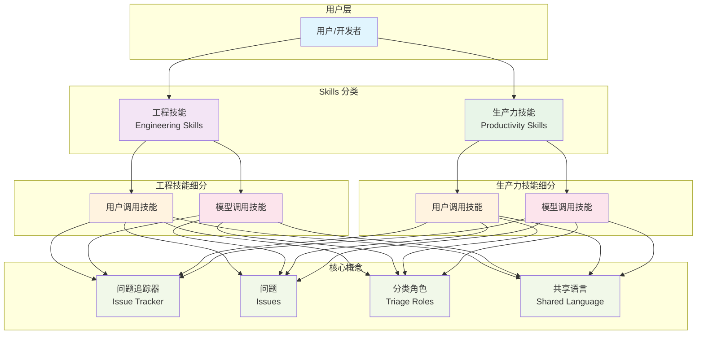

# Skills 整体架构图

## 图表说明

**整体架构**：Skills 仓库分为两大类技能：

1. **工程技能 (Engineering Skills)**：专注于代码开发工作
2. **生产力技能 (Productivity Skills)**：通用工作流程工具

每个技能类别又分为：
- **用户调用技能**：只能由用户通过命令触发
- **模型调用技能**：可以由用户或 AI 模型自动调用

**核心概念**：
- **问题追踪器 (Issue Tracker)**：管理项目问题的工具
- **问题 (Issues)**：被追踪的工作单元
- **分类角色 (Triage Roles)**：问题的状态标签
- **共享语言 (Shared Language)**：项目术语表，帮助 AI 理解项目上下文