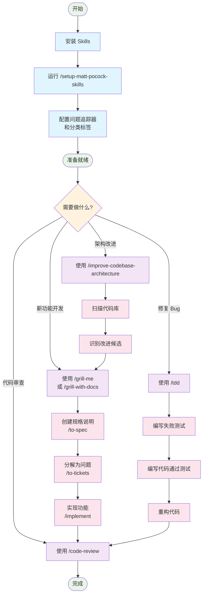

# Skills 工作流程图

## 工作流程说明

### 1. 安装和设置阶段
1. **安装 Skills**：通过 Claude Code 插件或 `npx skills` 命令
2. **运行设置命令**：`/setup-matt-pocock-skills`
3. **配置**：选择问题追踪器（GitHub Issues、Linear 或本地文件）和分类标签

### 2. 日常开发工作流

#### 新功能开发流程
1. **需求收集**：使用 `/grill-me` 或 `/grill-with-docs` 进行深入访谈
2. **创建规格**：使用 `/to-spec` 将对话转化为规格说明
3. **分解任务**：使用 `/to-tickets` 将规格分解为可管理的问题
4. **实现功能**：使用 `/implement` 进行开发
5. **代码审查**：使用 `/code-review` 进行审查

#### 测试驱动开发 (TDD) 流程
1. **红灯**：编写一个失败的测试
2. **绿灯**：编写代码使测试通过
3. **重构**：优化代码结构

#### 架构改进流程
1. **扫描**：使用 `/improve-codebase-architecture` 扫描代码库
2. **识别**：找到改进候选
3. **访谈**：使用 `/grill-me` 深入讨论改进方案

### 3. 核心优势
- **小步前进**：每个步骤都有明确的反馈
- **持续反馈**：通过测试和审查获得即时反馈
- **文档化**：自动记录决策和规格说明