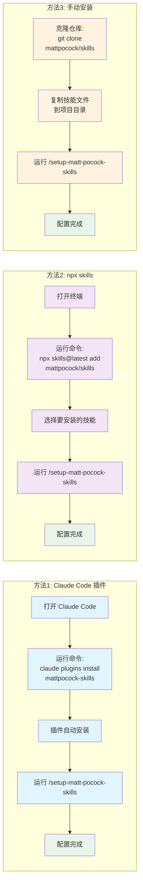

# Skills 安装步骤图



## 安装方法详解

### 方法 1: Claude Code 插件（推荐）

**优点**：
- 最简单快捷
- 自动更新
- 官方支持

**步骤**：
1. 打开 Claude Code
2. 运行安装命令：
   ```bash
   claude plugins install mattpocock-skills
   ```
3. 插件会自动安装所有技能
4. 运行设置命令：
   ```
   /setup-matt-pocock-skills
   ```

### 方法 2: npx skills（灵活）

**优点**：
- 可以选择性安装技能
- 适合想要自定义的用户
- 支持多种代理

**步骤**：
1. 打开终端
2. 运行安装命令：
   ```bash
   npx skills@latest add mattpocock/skills
   ```
3. 从列表中选择想要的技能（确保包含 `setup-matt-pocock-skills`）
4. 运行设置命令：
   ```
   /setup-matt-pocock-skills
   ```

### 方法 3: 手动安装（高级）

**优点**：
- 完全控制
- 可以修改技能文件
- 适合贡献者

**步骤**：
1. 克隆仓库：
   ```bash
   git clone https://github.com/mattpocock/skills.git
   ```
2. 复制技能文件到你的项目目录
3. 运行设置命令：
   ```
   /setup-matt-pocock-skills
   ```

## 设置过程

运行 `/setup-matt-pocock-skills` 后，系统会询问：

1. **问题追踪器选择**：
   - GitHub Issues
   - Linear
   - 本地文件（`.scratch/` 目录）

2. **分类标签设置**：
   - 用于 `/triage` 命令的标签
   - 例如：`needs-triage`, `ready-for-afk`

3. **文档存储位置**：
   - 指定文档保存目录

## 验证安装

安装完成后，可以尝试运行：
- `/grill-me` - 测试访谈功能
- `/ask-matt` - 询问适合的技能
- `/tdd` - 测试 TDD 功能