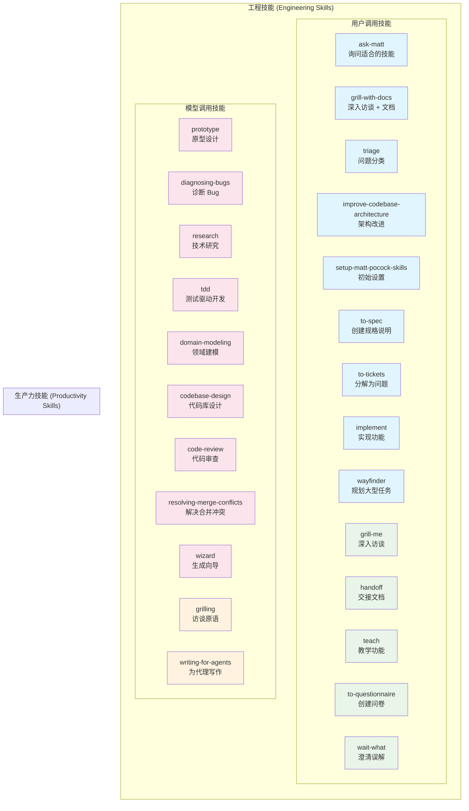
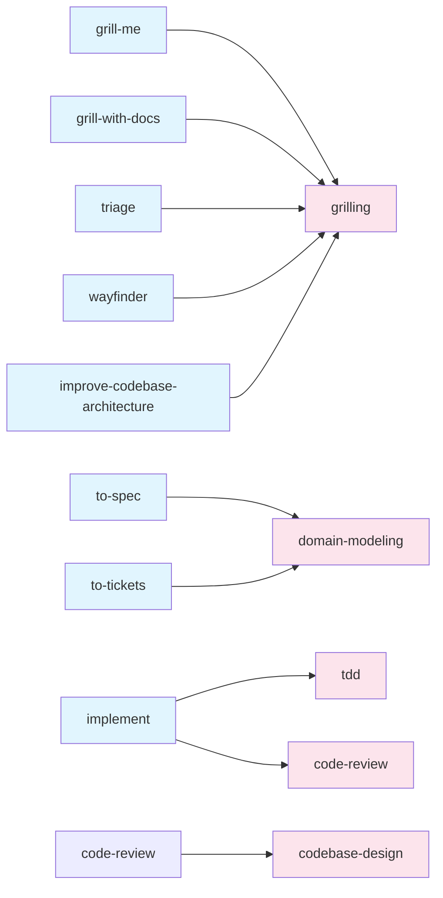

# Skills 功能对比图

## 技能详细说明

### 工程技能 (Engineering Skills)

#### 用户调用技能（只能由用户触发）

| 技能 | 用途 | 使用场景 |
|------|------|----------|
| **ask-matt** | 询问哪个技能适合当前情况 | 不确定使用哪个技能时 |
| **grill-with-docs** | 深入访谈并创建文档 | 开始新功能开发前 |
| **triage** | 对问题进行分类 | 处理问题列表时 |
| **improve-codebase-architecture** | 扫描并改进架构 | 定期代码库维护 |
| **setup-matt-pocock-skills** | 初始设置 | 首次安装后 |
| **to-spec** | 将对话转化为规格说明 | 需求讨论完成后 |
| **to-tickets** | 将规格分解为问题 | 规格创建后 |
| **implement** | 实现功能 | 开始编码时 |
| **wayfinder** | 规划大型任务 | 复杂项目规划 |

#### 模型调用技能（可由 AI 自动调用）

| 技能 | 用途 | 使用场景 |
|------|------|----------|
| **prototype** | 创建原型 | 验证设计想法 |
| **diagnosing-bugs** | 诊断复杂 Bug | 遇到难以调试的问题 |
| **research** | 技术研究 | 需要深入调查时 |
| **tdd** | 测试驱动开发 | 编写新功能时 |
| **domain-modeling** | 领域建模 | 理解业务逻辑 |
| **codebase-design** | 代码库设计 | 设计模块接口 |
| **code-review** | 代码审查 | 完成功能后 |
| **resolving-merge-conflicts** | 解决合并冲突 | Git 合并冲突时 |
| **wizard** | 生成向导 | 需要用户手动操作时 |

### 生产力技能 (Productivity Skills)

#### 用户调用技能

| 技能 | 用途 | 使用场景 |
|------|------|----------|
| **grill-me** | 深入访谈 | 非代码相关的需求 |
| **handoff** | 创建交接文档 | 切换工作上下文时 |
| **teach** | 教学功能 | 学习新技能时 |
| **to-questionnaire** | 创建问卷 | 需要他人输入时 |
| **wait-what** | 澄清误解 | 沟通不畅时 |

#### 模型调用技能

| 技能 | 用途 | 使用场景 |
|------|------|----------|
| **grilling** | 访谈原语 | 其他技能的基础 |
| **writing-for-agents** | 为代理写作 | 创建文档时 |

## 技能选择指南

### 根据任务类型选择

**新功能开发**：
1. `/grill-with-docs` → `/to-spec` → `/to-tickets` → `/implement` → `/code-review`

**Bug 修复**：
1. `/diagnosing-bugs` 或 `/tdd`

**架构改进**：
1. `/improve-codebase-architecture` → `/grill-me` → `/implement`

**代码审查**：
1. `/code-review`

**学习新技能**：
1. `/teach`

**技术研究**：
1. `/research`

### 根据项目阶段选择

**项目启动**：
- `/setup-matt-pocock-skills`（必须）
- `/grill-with-docs`（建立共享语言）

**日常开发**：
- `/grill-me`（需求澄清）
- `/tdd`（功能开发）
- `/code-review`（质量保证）

**维护阶段**：
- `/improve-codebase-architecture`（架构优化）
- `/diagnosing-bugs`（问题诊断）

## 技能关系图

