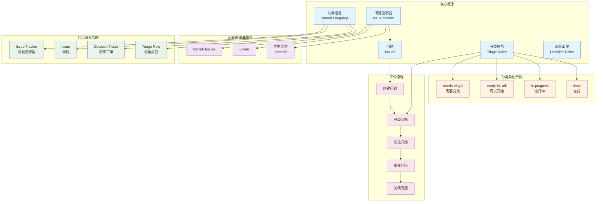
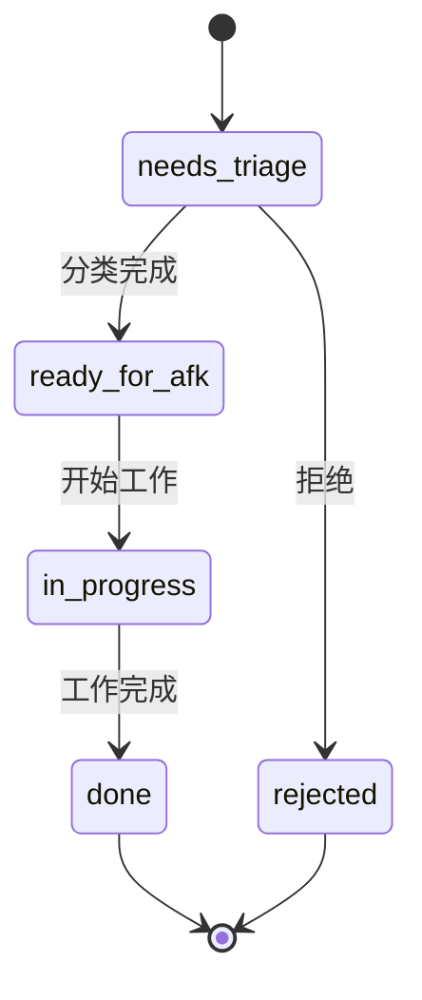
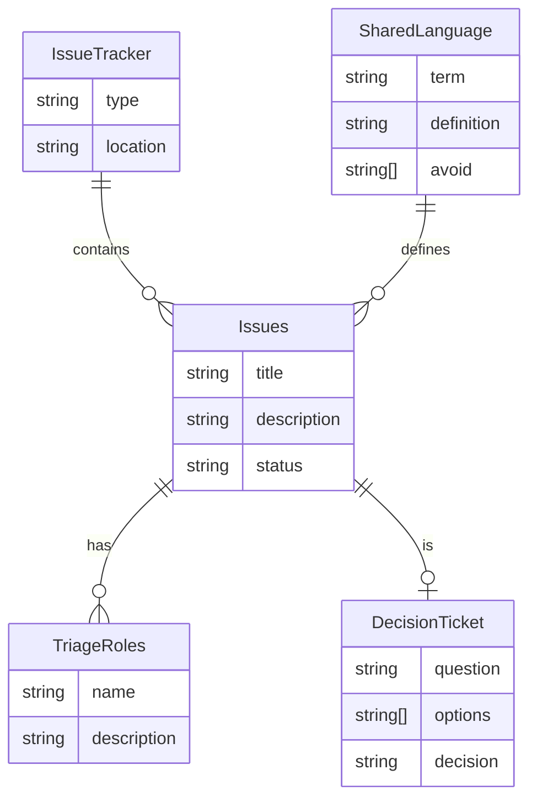

# Skills 核心概念图



## 核心概念详解

### 1. 问题追踪器 (Issue Tracker)

**定义**：管理项目问题的工具，用于跟踪工作进度。

**类型**：
- **GitHub Issues**：最常用的开源项目问题追踪
- **Linear**：现代化的项目管理工具
- **本地文件**：使用 `.scratch/` 目录的 Markdown 文件

**用途**：
- 存储和管理问题
- 跟踪工作进度
- 协作和沟通

### 2. 问题 (Issues)

**定义**：被追踪的工作单元，可以是：
- **Bug**：需要修复的问题
- **Task**：需要完成的任务
- **Spec**：规格说明
- **Slice**：功能切片

**示例**：
```markdown
# 用户登录功能

## 描述
实现用户登录功能，支持邮箱和密码登录。

## 验收标准
- [ ] 用户可以输入邮箱和密码
- [ ] 验证邮箱格式
- [ ] 验证密码强度
- [ ] 登录成功后跳转到首页
- [ ] 登录失败显示错误信息
```

### 3. 分类角色 (Triage Roles)

**定义**：问题的状态标签，用于管理工作流程。

**常见角色**：
- **needs-triage**：新创建的问题，需要分类
- **ready-for-afk**：已经分类，可以开始工作
- **in-progress**：正在进行中
- **done**：已完成

**工作流程**：


### 4. 共享语言 (Shared Language)

**定义**：项目术语表，帮助 AI 理解项目上下文。

**作用**：
- **减少沟通成本**：使用一致的术语
- **提高代码质量**：变量和函数命名更准确
- **加速 AI 理解**：AI 能更快理解项目

**示例**（来自 CONTEXT.md）：
```markdown
## Language

**Issue tracker**:
The tool that hosts a repo's issues: GitHub Issues, Linear, a local `.scratch/` markdown convention, or similar.
_Avoid_: backlog manager, backlog backend, issue host

**Issue**:
A single tracked unit of work inside an **Issue tracker**: a bug, task, spec, or slice produced by `to-tickets`.
_Avoid_: ticket (use only when quoting external systems that call them tickets, or for a **Decision ticket**, see below)

**Decision ticket**:
A `wayfinder` unit: a child **Issue** of a `wayfinder:map` holding a *question* whose resolution is a decision, not a slice of a build to execute.
```

### 5. 决策工单 (Decision Ticket)

**定义**：一种特殊的问题，用于记录需要做出的决策。

**特点**：
- 是问题的一种
- 需要做出决策，而不是执行任务
- 通常用于大型项目的规划阶段

**示例**：
```markdown
# 决策工单：选择数据库

## 问题
我们应该使用哪种数据库？

## 选项
1. PostgreSQL
2. MongoDB
3. MySQL

## 考虑因素
- 数据结构
- 性能要求
- 团队经验
- 成本

## 决策
选择 PostgreSQL，因为...
```

## 概念之间的关系



## 实际应用示例

### 场景：开发用户登录功能

1. **创建问题**：
   - 在问题追踪器中创建 Issue
   - 设置分类角色为 `needs-triage`

2. **分类问题**：
   - 使用 `/triage` 命令
   - 将角色改为 `ready-for-afk`

3. **实现功能**：
   - 使用 `/implement` 命令
   - 将角色改为 `in-progress`

4. **审查代码**：
   - 使用 `/code-review` 命令
   - 确保代码符合共享语言规范

5. **完成工作**：
   - 将角色改为 `done`
   - 关闭问题

### 场景：架构改进

1. **扫描代码库**：
   - 使用 `/improve-codebase-architecture`
   - 识别改进候选

2. **创建决策工单**：
   - 记录需要做出的决策
   - 列出选项和考虑因素

3. **做出决策**：
   - 使用 `/grill-me` 深入讨论
   - 记录最终决策

4. **实施改进**：
   - 根据决策创建问题
   - 使用 `/implement` 实施改进